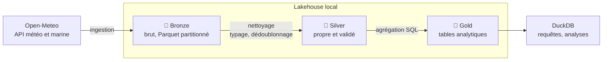

# Nami Data Platform

[](https://github.com/wanakin1/nami-data-platform/actions/workflows/ci.yml)

[](https://github.com/astral-sh/uv)
[](https://github.com/astral-sh/ruff)
[](LICENSE)

> Comme Nami, la navigatrice qui lit le ciel avant tout le monde : une plateforme de données
> **météo et marines** construite en architecture **Bronze / Silver / Gold**, sur une stack
> légère qui tient sur une seule machine.

Nami ingère chaque jour les observations météo (température, précipitations, vent) et marines
(hauteur des vagues) de plusieurs villes côtières depuis [Open-Meteo](https://open-meteo.com/),
les fiabilise, puis les expose sous forme de tables analytiques interrogeables en SQL.

> 🚧 **Projet en construction.** Le squelette est en place ; les couches sont développées
> issue par issue, voir la [roadmap](docs/roadmap.md).

## Architecture



| Couche | Contenu | Outil |
|---|---|---|
| **Bronze** | Les données telles que renvoyées par l'API, horodatées, jamais modifiées | Python, Parquet |
| **Silver** | Données typées, colonnes normalisées, doublons supprimés, valeurs aberrantes rejetées | Polars |
| **Gold** | Indicateurs métier : moyennes mensuelles, jours de pluie, records par ville | DuckDB (SQL) |

Le détail des choix est dans [docs/architecture.md](docs/architecture.md) et
[docs/adr/](docs/adr/).

## Stack

| Outil | Rôle |
|---|---|
| [Python](https://www.python.org/) 3.12+ | Langage |
| [uv](https://docs.astral.sh/uv/) | Environnements, dépendances, lockfile |
| [Polars](https://pola.rs/) | Transformations de DataFrames |
| [DuckDB](https://duckdb.org/) | Moteur SQL analytique embarqué |
| [Parquet](https://parquet.apache.org/) | Format de stockage en colonnes |
| [pytest](https://docs.pytest.org/) | Tests |
| [Ruff](https://docs.astral.sh/ruff/) | Lint et formatage |
| GitHub Actions | Intégration continue |

## Démarrage rapide

Prérequis : [uv](https://docs.astral.sh/uv/getting-started/installation/) installé.

```bash
git clone https://github.com/wanakin1/nami-data-platform.git
cd nami-data-platform
uv sync            # crée .venv et installe les dépendances figées dans uv.lock
uv run pytest      # lance les tests
```

L'installation détaillée et toutes les commandes : [docs/setup.md](docs/setup.md).

## Structure du projet

```
src/nami/
├── bronze/     ingestion des données brutes
├── silver/     nettoyage et validation
└── gold/       tables analytiques
tests/          tests pytest
data/           données locales (non versionnées)
docs/           architecture, ADR, roadmap, installation
```

## Contribuer

Chaque évolution part d'une [issue](https://github.com/wanakin1/nami-data-platform/issues),
se développe sur une branche `feat/<n°>-<slug>` créée depuis `dev`, et revient dans `dev` par une
pull request dont la CI est verte. À chaque version stable, `dev` est mergée dans `main` par une
pull request : `main` ne contient que des versions stables. Le détail du cycle est dans
[docs/setup.md](docs/setup.md#cycle-de-travail).

## Données

Données météo fournies par [Open-Meteo.com](https://open-meteo.com/), sous licence
[CC BY 4.0](https://creativecommons.org/licenses/by/4.0/).

## Licence

Code sous licence [MIT](LICENSE).
