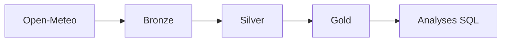

# Architecture

## Vue d'ensemble

Nami suit l'architecture **médaillon** : les données traversent trois couches, chacune plus
fiable que la précédente. Chaque couche ne lit que la couche juste en amont.



## Source : Open-Meteo

| API | Usage | URL |
|---|---|---|
| Historical Weather | Observations quotidiennes passées (température, pluie, vent) | `https://archive-api.open-meteo.com/v1/archive` |
| Marine | Hauteur des vagues | `https://marine-api.open-meteo.com/v1/marine` |

- Pas de clé d'API. Usage non commercial limité à 10 000 appels par jour.
- Licence CC BY 4.0 : l'attribution figure dans le README.
- Documentation : https://open-meteo.com/en/docs

## Les couches

### Bronze : le brut

- **Rôle** : garder une copie fidèle de ce que la source a renvoyé, pour pouvoir tout rejouer.
- **Règles** : on n'y corrige rien. On ajoute seulement des métadonnées d'ingestion (date
  d'extraction, source).
- **Format** : Parquet, partitionné par source et par date. Le schéma exact des chemins est
  décidé dans l'issue d'ingestion.
- **Propriété clé** : l'**idempotence**. Relancer une ingestion pour la même date ne crée pas
  de doublons.

### Silver : le propre

- **Rôle** : une table par entité, typée, dédupliquée, avec des noms de colonnes cohérents.
- **Règles** : les lignes invalides (valeurs hors plage physique, dates manquantes) sont
  écartées et comptées, jamais corrigées en silence.
- **Outil** : Polars, en mode lazy si possible.

### Gold : l'utile

- **Rôle** : des tables qui répondent à des questions (« quel mois a été le plus pluvieux à
  Brest ? »).
- **Outil** : DuckDB, en SQL, directement sur les fichiers Parquet de Silver.

## Organisation du code

```
src/nami/
├── bronze/   une fonction d'ingestion par source
├── silver/   une transformation par table
└── gold/     les requêtes SQL et leur exécution
```

Les données produites vivent dans `data/` (ignoré par git).

## Décisions

Les choix structurants sont consignés sous forme d'ADR (Architecture Decision Records) dans
[adr/](adr/). Toute nouvelle technologie ajoutée au projet fait l'objet d'un ADR.
